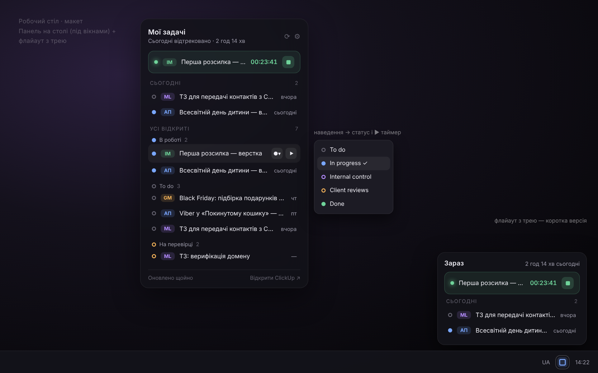

# ClickUp Widget

Спокійний дашборд задач ClickUp для Windows: панель на робочому столі й коротка картка з трею. Без червоних лічильників і сповіщень — задачі просто лежать там, де ти їх побачиш, коли сам захочеш.

## Що вміє

- **Панель на робочому столі.** Лежить під усіма вікнами, не зникає по Win+D, не з'являється на панелі завдань і в Alt+Tab. Перетягується за шапку, положення запам'ятовується (можна закріпити в меню).
- **Картка з трею.** Клік по значку — коротка версія: запущений таймер і задачі на сьогодні.
- **Твої відкриті задачі**, згруповані за статусом, як у ClickUp. Мітка проєкту (АП, GM, ML…) береться з назви задачі до двокрапки.
- **Сьогодні** — задачі з дедлайном сьогодні або вже минулим. Без кольорових акцентів.
- **Статус і таймер одним кліком.** Наведи на задачу: ⌄ змінює статус, ▶ запускає трекінг часу (попередній таймер зупиняється сам). Клік по задачі відкриває її в ClickUp.
- **Час за сьогодні** у шапці, разом із запущеним таймером.
- **Тихий інбокс** — окреме маленьке віконце на столі лише з двома речами: нові коментарі інших людей у твоїх задачах і зміни статусів. Призначень, твоїх власних коментарів і статусів, які ти змінив через віджет, там немає. Нове позначене маленькою крапкою, ✓ позначає все прочитаним. ClickUp не має публічного API для свого Inbox, тому віджет сам порівнює задачі між оновленнями — події з'являються, поки віджет запущений.
- Темна й світла теми, автозапуск, тихе оновлення (лише рядок унизу панелі, без спливаючих вікон).

## Встановлення

1. Завантаж `ClickUpWidget-win-Setup.exe` з [останнього релізу](https://github.com/dimasdonetsk/clickupwidget/releases/latest) і запусти.
2. Віджет попросить особистий API-токен ClickUp: **аватар унизу зліва → Settings → Apps → API Token → Generate / Copy**. Встав його у вікно — готово.

Токен зберігається лише на цьому комп'ютері, зашифрований під твій обліковий запис Windows (DPAPI). Віджет звертається тільки до `api.clickup.com`.

## Як прибрати відволікання в самому ClickUp

Віджет показує задачі, тож сповіщення ClickUp можна приглушити: **Settings → Notifications** → для подій про призначення задач вимкни Email, Browser і Mobile. Червону цифру на значку прибирають налаштування Windows (Панель завдань → значки на кнопках) і телефона (значки програм).

## Збірка

Кожен push у `main` збирає програму на GitHub Actions. Якщо в `src/ClickUpWidget.csproj` нова `<Version>`, створюється реліз з інсталятором, і встановлені копії оновлюються самі.

Локально: встанови .NET 8 SDK і запусти `build.bat` — готовий `ClickUpWidget.exe` буде в папці `out`.

Налаштування, стан інбоксу й журнал: `%AppData%\ClickUpWidget`.
